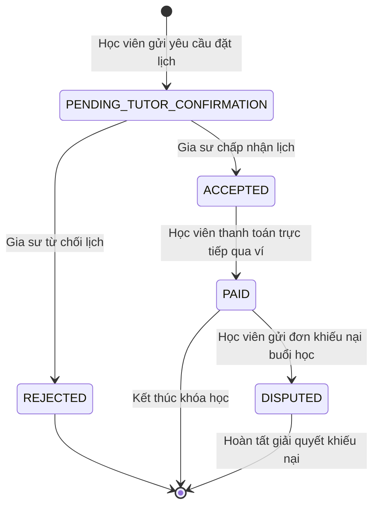
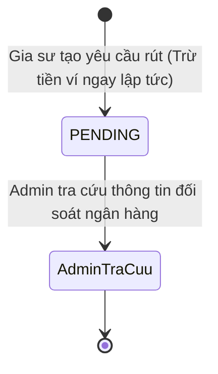
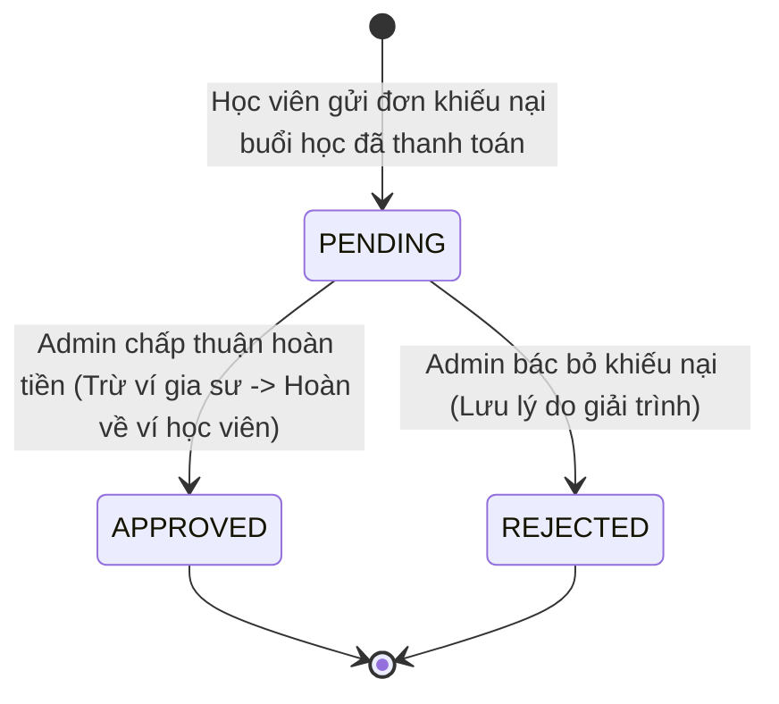
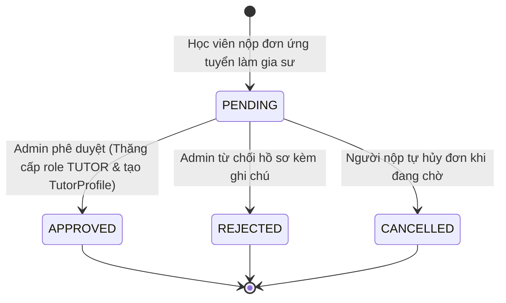

# TUTORTECH - NỀN TẢNG KẾT NỐI GIA SƯ VÀ HỌC TẬP TRỰC TUYẾN 1 KÈM 1

> **Đồ án môn học**: Phân tích & Thiết kế Hệ thống Hướng đối tượng (OOAD) / Lập trình Hướng đối tượng Java  
> **Kiến trúc áp dụng**: Mô hình **MVC (Model - View - Controller/DAO)** theo chuẩn giáo trình PTIT (*Software: Art of Design and Programming*).  
> **Công nghệ nền tảng**: Java 17+, Java Swing (UI FlatLaf hiện đại), PostgreSQL, JDBC thuần, Apache Maven, JUnit 4.

---

## 📌 MỤC LỤC
1. [Giới thiệu Đề tài & Mục tiêu Hệ thống](#1-giới-thiệu-đề-tài--mục-tiêu-hệ-thống)
2. [Kiến trúc & Phong cách Thiết kế (MVC)](#2-kiến-trúc--phong-cách-thiết-kế-mvc)
3. [Danh mục Phân hệ & Toàn bộ Luồng Nghiệp vụ có trong Dự án](#3-danh-mục-phân-hệ--toàn-bộ-luồng-nghiệp-vụ-có-trong-dự-án)
4. [Sơ đồ Chuyển trạng thái & Vòng đời Dữ liệu (State Machine Diagrams)](#4-sơ-đồ-chuyển-trạng-thái--vòng-đời-dữ-liệu)
5. [Mô hình Dữ liệu (10 Bảng Thực thể CSDL PostgreSQL)](#5-mô-hình-dữ-liệu-10-bảng-thực-thể-csdl-postgresql)
6. [Các Quy tắc Nghiệp vụ & Giao dịch Nguyên tử (Atomic Transactions)](#6-các-quy-tắc-nghiệp-vụ--giao-dịch-nguyên-tử)
7. [Cấu trúc Thư mục Dự án](#7-cấu-trúc-thư-mục-dự-án)
8. [Hướng dẫn Cài đặt & Khởi chạy](#8-hướng-dẫn-cài-đặt--khởi-chạy)
9. [Dữ liệu Khởi tạo Kiểm thử (Seed Data Chuẩn BTL)](#9-dữ-liệu-khởi-tạo-kiểm-thử-seed-data-chuẩn-btl)
10. [Kịch bản Kiểm thử & Demo Khép kín Toàn Hệ thống](#10-kịch-bản-kiểm-thử--demo-khép-kín-toàn-hệ-thống)
11. [Phân tích Các Luồng Nghiệp vụ Bị Thiếu & Định hướng Hoàn thiện](#11-phân-tích-các-luồng-nghiệp-vụ-bị-thiếu--định-hướng-hoàn-thiện)

---

## 1. GIỚI THIỆU ĐỀ TÀI & MỤC TIÊU HỆ THỐNG

**TutorTech** là hệ thống phần mềm máy tính để bàn (Desktop Application) giải quyết trọn vẹn bài toán kết nối học tập 1 kèm 1 giữa **Học viên** (*Student*) và **Gia sư** (*Tutor*), dưới sự giám sát và vận hành toàn diện của **Quản trị viên** (*Admin*).

### Các phân hệ nghiệp vụ chính:
- **Phân hệ Học viên**:
  - Tra cứu hồ sơ gia sư, môn học, mức đánh giá và danh sách gói dịch vụ.
  - Đặt lịch hẹn học kèm có thuật toán kiểm tra chống trùng lịch (*Collision Detection*).
  - Quản lý lịch học và thanh toán học phí trực tiếp bằng ví cá nhân khi gia sư chấp nhận.
  - Khiếu nại buổi học và yêu cầu chuyển hoàn học phí khi có sự cố tranh chấp.
  - Nạp tiền vào ví qua Cổng thanh toán mô phỏng (*Mock Payment Gateway*).
  - Nộp và theo dõi trạng thái hồ sơ ứng tuyển để nâng cấp tài khoản lên làm Gia sư.
- **Phân hệ Gia sư**:
  - Tự thiết lập, định giá và quản lý các gói dịch vụ giảng dạy cá nhân cung cấp.
  - Tiếp nhận và xử lý yêu cầu đặt lịch học: Chấp nhận (`ACCEPTED`) hoặc Từ chối (`REJECTED`).
  - Quản lý ví gia sư và tạo yêu cầu rút tiền về tài khoản ngân hàng.
- **Phân hệ Quản trị viên**:
  - Quản lý người dùng: Tra cứu, Khóa hoặc Mở khóa tài khoản (có cơ chế an toàn chống tự khóa).
  - Xét duyệt hồ sơ ứng tuyển gia sư: Thăng cấp vai trò thành `TUTOR` và tự động khởi tạo `TutorProfile`.
  - Giám sát gói dịch vụ giảng dạy của toàn bộ gia sư trên nền tảng.
  - Thẩm định khiếu nại tranh chấp và xử lý chuyển hoàn tiền học phí từ ví gia sư về ví học viên.
  - Tra cứu yêu cầu rút tiền (đối soát ngân hàng với số tài khoản được che bảo mật `••••1234`).
  - Tra cứu và kiểm toán nhật ký thao tác toàn hệ thống (`ActionLog`).

### Các thành phần tinh gọn đúng theo chuẩn đồ án:
- ❌ Không làm các bảng quản lý nội dung video, khóa học, bài học (`Course`, `Lesson`).
- ❌ Không lưu token đăng nhập (JWT/SessionToken) trong CSDL; trạng thái phiên `currentUser` được quản lý trực tiếp trong bộ nhớ JVM và giải phóng khi Đăng xuất.
- ❌ Không dùng ví trung gian ký quỹ (Escrow); học phí được chuyển trực tiếp giữa ví học viên và ví gia sư.

---

## 2. KIẾN TRÚC & PHONG CÁCH THIẾT KẾ (MVC)

Hệ thống được tổ chức chặt chẽ theo mô hình **MVC 3 tầng (Model - View - Controller/DAO)**:

```
        Actor (Khách / Học viên / Gia sư / Quản trị viên)
                                │
                                ▼
┌───────────────────────────────────────────────────────────────┐
│                       VIEW / BOUNDARY                         │
│ Java Swing (JFrame, JDialog, JTable), giao diện FlatLaf       │
│ Bắt sự kiện người dùng qua ActionListener                     │
└───────────────────────────────┬───────────────────────────────┘
                                │ Gọi phương thức DAO
                                ▼
┌───────────────────────────────────────────────────────────────┐
│                        DAO / CONTROL                          │
│ Lớp cha DAO.java quản lý kết nối Connection JDBC dùng chung   │
│ Các lớp DAO con đảm nhận nghiệp vụ, kiểm tra tính hợp lệ,     │
│ thực thi PreparedStatement và quản trị Transaction nguyên tử  │
└───────────────┬───────────────────────────────┬───────────────┘
                │ Ánh xạ 1-1                    │ Truy vấn SQL
                ▼                               ▼
┌───────────────────────────────┐   ┌───────────────────────────┐
│        MODEL / ENTITY         │   │      CSDL POSTGRESQL      │
│ 10 Lớp POJO độc lập,          │   │ 10 Bảng quan hệ với       │
│ triển khai Serializable       │   │ tiền tố tbl*, khóa UUID   │
└───────────────────────────────┘   └───────────────────────────┘
```

- **`model` (Entity)**: Đại diện cho dữ liệu nghiệp vụ, ánh xạ 1-1 với 10 bảng trong PostgreSQL, không chứa logic truy xuất CSDL, đầy đủ getter, setter, constructor.
- **`dao` (Control / Data Access)**: Quản lý toàn bộ câu lệnh SQL, ánh xạ kết quả `ResultSet` sang `Entity`. Quản trị các giao dịch tài chính với tính toàn vẹn ACID bằng `con.setAutoCommit(false)`, `con.commit()`, `con.rollback()`.
- **`view` (Boundary)**: Phân tách thành 4 package tương ứng với các nhóm người dùng:
  - `view.auth`: Đăng nhập, Đăng ký.
  - `view.student`: Màn hình chính học viên, tìm gia sư, đặt lịch, thanh toán, khiếu nại, nạp tiền, ứng tuyển gia sư.
  - `view.tutor`: Màn hình chính gia sư, duyệt lịch đặt, quản lý gói dịch vụ, tạo yêu cầu rút tiền.
  - `view.admin`: Màn hình chính admin, quản lý user, duyệt ứng tuyển, tra cứu gói, duyệt khiếu nại, tra cứu rút tiền, tra cứu nhật ký audit log.

---

## 3. DANH MỤC PHÂN HỆ & TOÀN BỘ LUỒNG NGHIỆP VỤ CÓ TRONG DỰ ÁN

Toàn bộ các luồng nghiệp vụ hiện có trong mã nguồn dự án được tổ chức theo từng phân hệ người dùng:

### 3.1. Phân hệ Xác thực & Quản lý Phiên (Authentication & Session)
1. **Đăng ký tài khoản mới (`RegisterFrm`)**: Khách vãng lai đăng ký tài khoản với tên đăng nhập duy nhất. Hệ thống tự động cấp ngay một ví tiền cá nhân với số dư ban đầu 0 VNĐ.
2. **Đăng nhập hệ thống (`LoginFrm`)**: Xác thực thông tin đăng nhập, kiểm tra trạng thái tài khoản không bị `LOCKED`. Phân quyền theo vai trò (`STUDENT`, `TUTOR`, `ADMIN`) để điều hướng mở đúng giao diện chính tương ứng.
3. **Đăng xuất an toàn**: Hiển thị hộp thoại xác nhận kết thúc phiên trên tất cả các màn hình Home, xóa sạch tham chiếu `currentUser` trong bộ nhớ và quay về màn hình Đăng nhập.

### 3.2. Phân hệ Học viên (Student Module)
4. **Tra cứu hồ sơ & Gói dịch vụ gia sư (`TutorSearchFrm`, `TutorDetailFrm`)**: Tìm kiếm theo tên gia sư, môn học hoặc từ khóa chuyên môn. Xem chi tiết hồ sơ cá nhân, điểm đánh giá (`rating`) và các gói học đang hoạt động.
5. **Đặt lịch thuê gia sư (`BookingRequestFrm`)**: Chọn gói học, ngày giờ bắt đầu và thời lượng. Hệ thống tự động kích hoạt thuật toán phát hiện xung đột thời gian (Collision Detection) đối chiếu với các lịch đã xác nhận của gia sư trước khi tạo đơn `PENDING_TUTOR_CONFIRMATION`.
6. **Quản lý lịch học & Thanh toán học phí trực tiếp bằng ví (`PaymentCheckoutFrm`)**: Học viên theo dõi tiến trình lịch học. Khi lịch học được gia sư chấp nhận (`ACCEPTED`), học viên thực hiện thanh toán trực tiếp. Hệ thống trừ tiền ví học viên, cộng tiền ví gia sư và cập nhật trạng thái `PAID` trong cùng một giao dịch nguyên tử.
7. **Khiếu nại buổi học & Yêu cầu hoàn tiền (`CreateDisputeFrm`)**: Đối với các buổi học đã thanh toán (`PAID`), nếu gia sư vắng mặt hoặc vi phạm cam kết, học viên gửi khiếu nại kèm lý do, bằng chứng và số tiền đề nghị hoàn lại $\rightarrow$ Tạo bản ghi `tblDispute` trạng thái `PENDING`.
8. **Nạp tiền vào ví qua Cổng thanh toán mô phỏng (`WalletTopUpFrm`, `MockPaymentGatewayFrm`)**: Học viên nhập số tiền cần nạp, hệ thống tạo giao dịch `DEPOSIT/PENDING` và mở giao diện mô phỏng cổng thanh toán để xác nhận `SUCCESS` (cộng số dư khả dụng) hoặc `FAILED`.
9. **Nộp và theo dõi hồ sơ ứng tuyển làm gia sư (`TutorApplicationFrm`)**: Học viên điền thông tin giới thiệu, môn có thể dạy, liên kết CV và bài kiểm tra chuyên môn. Hồ sơ được lưu ở trạng thái `PENDING` chờ quản trị viên xét duyệt (học viên có thể hủy hồ sơ khi đang chờ).

### 3.3. Phân hệ Gia sư (Tutor Module)
10. **Tiếp nhận & Xử lý yêu cầu đặt lịch (`TutorBookingFrm`)**: Gia sư xem danh sách các lịch học học viên gửi tới. Sau khi xem xét thời gian và ghi chú, gia sư lựa chọn **Chấp nhận** (`ACCEPTED` - cho phép học viên thanh toán) hoặc **Từ chối** (`REJECTED`).
11. **Thiết lập & Quản lý gói dịch vụ giảng dạy (`TutorPackageManagerFrm`)**: Gia sư tự cấu hình danh mục các gói học cá nhân cung cấp (Tên gói, mô tả, mức học phí, kích hoạt/tạm dừng). Dữ liệu này làm cơ sở cho học viên tìm kiếm và đặt lịch.
12. **Yêu cầu rút tiền về ngân hàng (`CreateWithdrawalFrm`)**: Gia sư nhập số tiền muốn rút (không vượt quá số dư khả dụng trong ví), tên ngân hàng, số tài khoản và tên chủ thẻ. Hệ thống trừ tiền trong ví và tạo yêu cầu rút tiền `tblWithdrawal` ở trạng thái `PENDING`.

### 3.4. Phân hệ Quản trị viên (Admin Module)
13. **Quản trị người dùng & Trạng thái tài khoản (`AdminUserManagementFrm`)**: Tìm kiếm tài khoản theo tên, vai trò và trạng thái; thực hiện Khóa (`LOCKED`) hoặc Mở khóa (`ACTIVE`). Hệ thống chặn không cho quản trị viên tự khóa chính tài khoản của mình.
14. **Xét duyệt hồ sơ ứng tuyển gia sư (`AdminApplicationReviewFrm`)**: Thẩm định thông tin ứng viên, CV và bài test. Nếu Chấp thuận: Cập nhật hồ sơ `APPROVED`, chuyển đổi vai trò người dùng thành `TUTOR`, tự động khởi tạo hồ sơ `TutorProfile` với điểm đánh giá khởi điểm 5.0 và ghi nhận nhật ký kiểm toán.
15. **Giám sát danh mục gói dịch vụ (`AdminPackageInquiryFrm`)**: Tra cứu và kiểm tra thông tin, giá cả và tình trạng hoạt động của toàn bộ các gói dịch vụ do các gia sư thiết lập trên hệ thống.
16. **Xử lý khiếu nại & Chuyển hoàn học phí (`AdminDisputeReviewFrm`)**: Thẩm tra lý do và bằng chứng khiếu nại. Nếu chấp thuận: Hệ thống tự động chuyển số tiền hoàn từ ví gia sư trả về ví học viên và cập nhật khiếu nại sang `APPROVED`. Nếu từ chối: Cập nhật `REJECTED` kèm ghi chú giải trình.
17. **Tra cứu yêu cầu rút tiền (`AdminWithdrawalInquiryFrm`)**: Xem danh sách rút tiền với số tài khoản được che bảo mật (`••••1234`), hỗ trợ quản trị viên đối soát tài chính ngân hàng.
18. **Tra cứu nhật ký kiểm toán hệ thống (`AdminActionLogInquiryFrm`)**: Tra cứu lịch sử toàn bộ các hành động quản trị và biến động quan trọng (`APPLY_TUTOR`, `UPDATE_USER_STATUS`, `REVIEW_TUTOR_APPLICATION`, `RESOLVE_DISPUTE`...) kèm định danh người thực hiện, thời gian, IP và User-Agent.

---

### 3.5. Bảng tổng hợp Phân hệ - Giao diện - Lớp DAO - Bảng CSDL

| STT | Luồng Nghiệp vụ | Tác tử chính | Giao diện (View) | Lớp DAO xử lý | Bảng CSDL tác động |
| :---: | :--- | :--- | :--- | :--- | :--- |
| **01** | Đăng ký tài khoản | Khách | `RegisterFrm` | `UserDAO`, `WalletDAO` | `tblUser`, `tblWallet` |
| **02** | Đăng nhập & Đăng xuất | Tất cả | `LoginFrm`, các `*HomeFrm` | `UserDAO` | `tblUser` |
| **03** | Tra cứu gia sư & gói học | Học viên | `TutorSearchFrm`, `TutorDetailFrm` | `UserDAO`, `TutorProfileDAO`, `BrokeragePackageDAO` | `tblUser`, `tblTutorProfile`, `tblBrokeragePackage` |
| **04** | Đặt lịch thuê gia sư | Học viên | `BookingRequestFrm` | `BookingDAO`, `BrokeragePackageDAO` | `tblBooking` |
| **05** | Quản lý & Thanh toán tiền học | Học viên | `PaymentCheckoutFrm` | `BookingDAO`, `WalletDAO`, `PaymentTransactionDAO` | `tblBooking`, `tblWallet`, `tblPaymentTransaction` |
| **06** | Nạp tiền ví qua Cổng mô phỏng | Học viên | `WalletTopUpFrm`, `MockPaymentGatewayFrm` | `WalletDAO`, `PaymentTransactionDAO` | `tblWallet`, `tblPaymentTransaction` |
| **07** | Nộp hồ sơ ứng tuyển gia sư | Học viên | `TutorApplicationFrm` | `TutorApplicationDAO`, `ActionLogDAO` | `tblTutorApplication`, `tblActionLog` |
| **08** | Khiếu nại buổi học & hoàn tiền | Học viên | `CreateDisputeFrm` | `DisputeDAO` | `tblDispute` |
| **09** | Tiếp nhận & phản hồi lịch đặt | Gia sư | `TutorBookingFrm` | `BookingDAO` | `tblBooking` |
| **10** | Quản lý gói dịch vụ giảng dạy | Gia sư | `TutorPackageManagerFrm` | `BrokeragePackageDAO` | `tblBrokeragePackage` |
| **11** | Yêu cầu rút tiền về ngân hàng | Gia sư | `CreateWithdrawalFrm` | `WithdrawalDAO`, `WalletDAO` | `tblWithdrawal`, `tblWallet` |
| **12** | Quản lý tài khoản người dùng | Admin | `AdminUserManagementFrm` | `UserDAO`, `ActionLogDAO` | `tblUser`, `tblActionLog` |
| **13** | Xét duyệt hồ sơ ứng tuyển | Admin | `AdminApplicationReviewFrm` | `TutorApplicationDAO`, `UserDAO`, `TutorProfileDAO`, `ActionLogDAO` | `tblTutorApplication`, `tblUser`, `tblTutorProfile`, `tblActionLog` |
| **14** | Giám sát danh sách gói học | Admin | `AdminPackageInquiryFrm` | `BrokeragePackageDAO`, `UserDAO` | `tblBrokeragePackage`, `tblUser` |
| **15** | Xử lý khiếu nại hoàn tiền | Admin | `AdminDisputeReviewFrm` | `DisputeDAO`, `WalletDAO`, `PaymentTransactionDAO`, `ActionLogDAO` | `tblDispute`, `tblWallet`, `tblPaymentTransaction`, `tblActionLog` |
| **16** | Tra cứu yêu cầu rút tiền | Admin | `AdminWithdrawalInquiryFrm` | `WithdrawalDAO`, `UserDAO` | `tblWithdrawal` |
| **17** | Tra cứu nhật ký kiểm toán | Admin | `AdminActionLogInquiryFrm` | `ActionLogDAO`, `UserDAO` | `tblActionLog` |

---

## 4. SƠ ĐỒ CHUYỂN TRẠNG THÁI & VÒNG ĐỜI DỮ LIỆU

Hệ thống quản lý trạng thái các thực thể kinh doanh qua máy trạng thái (State Machine) rõ ràng:

### 4.1. Vòng đời Lịch học (`tblBooking`)


### 4.2. Vòng đời Yêu cầu Rút tiền (`tblWithdrawal`)


### 4.3. Vòng đời Khiếu nại Tranh chấp (`tblDispute`)


### 4.4. Vòng đời Hồ sơ Ứng tuyển Gia sư (`tblTutorApplication`)


---

## 5. MÔ HÌNH DỮ LIỆU (10 BẢNG THỰC THỂ CSDL POSTGRESQL)

Cơ sở dữ liệu sử dụng tiền tố **`tbl*`**, toàn bộ khóa chính dùng định danh duy nhất chuẩn **`UUID`**:

1. **`tblUser`**: Tài khoản người dùng (`id`, `username`, `password_hash`, `email`, `display_name`, `role` [STUDENT, TUTOR, ADMIN], `status` [ACTIVE, LOCKED], `phone`, `created_at`, `updated_at`).
2. **`tblTutorProfile`**: Hồ sơ gia sư (`user_id` PK/FK quan hệ 1–1 với `tblUser`, `bio`, `subjects_can_teach`, `rating` mặc định 5.00).
3. **`tblTutorApplication`**: Hồ sơ ứng tuyển gia sư (`id`, `user_id`, `bio`, `subjects_can_teach`, `cv_url`, `test_submission`, `status` [PENDING, APPROVED, REJECTED], `admin_note`).
4. **`tblBrokeragePackage`**: Gói dịch vụ gia sư (`id`, `tutor_id`, `name`, `description`, `price` > 0, `active`).
5. **`tblBooking`**: Đơn đặt lịch học (`id`, `student_id`, `tutor_id`, `package_id`, `scheduled_at`, `duration_minutes` > 0, `note`, `status` [PENDING_TUTOR_CONFIRMATION, ACCEPTED, REJECTED, PAID, CANCELLED], `total_price` >= 0).
6. **`tblWallet`**: Ví tiền người dùng (`id`, `user_id` UNIQUE, `available_balance` >= 0).
7. **`tblPaymentTransaction`**: Lịch sử giao dịch tiền (`id`, `source_wallet_id`, `destination_wallet_id`, `booking_id`, `type` [DEPOSIT, TRANSFER, REFUND], `status` [PENDING, SUCCESS, FAILED], `amount` > 0, `reference_code` UNIQUE, `balance_after`).
8. **`tblDispute`**: Đơn khiếu nại buổi học (`id`, `booking_id`, `created_by_id`, `reason`, `evidence_url`, `status` [PENDING, APPROVED, REJECTED], `refund_amount` >= 0, `admin_note`).
9. **`tblWithdrawal`**: Đơn đề nghị rút tiền (`id`, `user_id`, `wallet_id`, `amount` > 0, `bank_name`, `account_number`, `account_holder`, `status` [PENDING, PROCESSING, COMPLETED, REJECTED]).
10. **`tblActionLog`**: Nhật ký kiểm toán quản trị (`id`, `user_id`, `action`, `target_type`, `target_id`, `ip_address`, `user_agent`, `created_at`).

---

## 6. CÁC QUY TẮC NGHIỆP VỤ & GIAO DỊCH NGUYÊN TỬ

1. **Phát hiện Trùng lịch (Collision Detection)**: Khi học viên gửi đơn đặt lịch, hệ thống kiểm tra khoảng thời gian đề xuất $[t_{\text{start}}, t_{\text{start}} + \text{duration}]$ có giao với bất kỳ lịch nào đã được gia sư chấp nhận (`ACCEPTED`) hoặc đã thanh toán (`PAID`) hay không. Nếu trùng lặp, hệ thống chặn gửi đơn.
2. **Giao dịch Thanh toán Học phí Nguyên tử (Atomic Transfer)**:
   - Trừ tiền từ ví học viên: `available_balance = available_balance - totalPrice`.
   - Cộng tiền vào ví gia sư: `available_balance = available_balance + totalPrice`.
   - Đổi trạng thái lịch học sang `PAID`.
   - Tạo bản ghi `PaymentTransaction` loại `TRANSFER` trạng thái `SUCCESS`.
   - Bốn thao tác được bọc trong một **Database Transaction**: Nếu xảy ra bất kỳ lỗi nào, hệ thống tự động `rollback()` hoàn toàn trạng thái cũ.
3. **Hoàn tiền Khiếu nại Trực tiếp (Refund Transaction)**: Khi Admin duyệt khiếu nại hoàn tiền, hệ thống trừ số tiền hoàn từ ví gia sư và hoàn lại ví học viên, đồng thời ghi giao dịch `REFUND`. Nếu số dư ví gia sư không đủ, hệ thống sẽ cảnh báo không thể hoàn tiền.
4. **An toàn Quản trị**: Hệ thống nghiêm cấm Quản trị viên tự khóa tài khoản của chính mình đang thực hiện phiên làm việc.
5. **Bảo mật Rút tiền**: Màn hình quản trị luôn tự động che số tài khoản ngân hàng (dạng `••••1234`) để đảm bảo quyền riêng tư của gia sư.

---

## 7. CẤU TRÚC THƯ MỤC DỰ ÁN

```text
TutorTech/
├── database/
│   └── tutortech_schema.sql         # Script tạo 10 bảng CSDL PostgreSQL & Dữ liệu mẫu kiểm thử
├── src/
│   ├── main/
│   │   ├── java/
│   │   │   ├── Main.java            # Khởi chạy ứng dụng (Entry point)
│   │   │   ├── model/               # 10 Lớp thực thể (POJO Model)
│   │   │   │   ├── User.java
│   │   │   │   ├── TutorProfile.java
│   │   │   │   ├── TutorApplication.java
│   │   │   │   ├── BrokeragePackage.java
│   │   │   │   ├── Booking.java
│   │   │   │   ├── Wallet.java
│   │   │   │   ├── PaymentTransaction.java
│   │   │   │   ├── Dispute.java
│   │   │   │   ├── Withdrawal.java
│   │   │   │   └── ActionLog.java
│   │   │   ├── dao/                 # 10 Lớp Data Access Object (Control)
│   │   │   │   ├── DAO.java         # Lớp cơ sở kết nối JDBC PostgreSQL
│   │   │   │   ├── UserDAO.java
│   │   │   │   ├── TutorProfileDAO.java
│   │   │   │   ├── TutorApplicationDAO.java
│   │   │   │   ├── BrokeragePackageDAO.java
│   │   │   │   ├── BookingDAO.java
│   │   │   │   ├── WalletDAO.java
│   │   │   │   ├── PaymentTransactionDAO.java
│   │   │   │   ├── DisputeDAO.java
│   │   │   │   ├── WithdrawalDAO.java
│   │   │   │   └── ActionLogDAO.java
│   │   │   └── view/                # 22 Màn hình giao diện Java Swing (Boundary)
│   │   │       ├── auth/
│   │   │       │   ├── LoginFrm.java
│   │   │       │   └── RegisterFrm.java
│   │   │       ├── student/
│   │   │       │   ├── StudentHomeFrm.java
│   │   │       │   ├── TutorSearchFrm.java
│   │   │       │   ├── TutorDetailFrm.java
│   │   │       │   ├── BookingRequestFrm.java
│   │   │       │   ├── PaymentCheckoutFrm.java
│   │   │       │   ├── CreateDisputeFrm.java
│   │   │       │   ├── WalletTopUpFrm.java
│   │   │       │   ├── MockPaymentGatewayFrm.java
│   │   │       │   └── TutorApplicationFrm.java
│   │   │       ├── tutor/
│   │   │       │   ├── TutorHomeFrm.java
│   │   │       │   ├── TutorBookingFrm.java
│   │   │       │   ├── TutorPackageManagerFrm.java
│   │   │       │   └── CreateWithdrawalFrm.java
│   │   │       └── admin/
│   │   │           ├── AdminHomeFrm.java
│   │   │           ├── AdminUserManagementFrm.java
│   │   │           ├── AdminApplicationReviewFrm.java
│   │   │           ├── AdminPackageInquiryFrm.java
│   │   │           ├── AdminDisputeReviewFrm.java
│   │   │           ├── AdminWithdrawalInquiryFrm.java
│   │   │           └── AdminActionLogInquiryFrm.java
│   │   └── resources/
│   │       └── db.properties        # Thông số cấu hình URL, user, pass CSDL
│   └── test/
│       └── java/dao/                # 11 Unit test cases JUnit 4 cho tầng DAO
│           ├── UserDAOTest.java
│           ├── BookingDAOTest.java
│           └── WalletDAOTest.java
├── pom.xml                          # Maven POM Dependencies & Exec plugin
└── README.md
```

---

## 8. HƯỚNG DẪN CÀI ĐẶT & KHỞI CHẠY

### Điều kiện tiên quyết:
- **JDK 17** trở lên.
- **Apache Maven 3.8+**.
- **PostgreSQL 12+** (Đang chạy dịch vụ tại cổng `5432`).

### Bước 1: Khởi tạo Cơ sở dữ liệu PostgreSQL
1. Mở `pgAdmin`, `DBeaver` hoặc terminal `psql`.
2. Tạo database mới tên là `tutortech`:
   ```sql
   CREATE DATABASE tutortech;
   ```
3. Mở và thực thi toàn bộ nội dung file script:
   `database/tutortech_schema.sql`
   *(Script sẽ tự động khởi tạo cấu trúc 10 bảng và nạp sẵn toàn bộ dữ liệu mẫu theo Mục 5.1 của BTL.docx).*

### Bước 2: Cấu hình kết nối CSDL
Mở file `src/main/resources/db.properties` và điều chỉnh lại username/mật khẩu PostgreSQL phù hợp với máy của bạn:
```properties
db.url=jdbc:postgresql://localhost:5432/tutortech
db.user=postgres
db.password=YOUR_PASSWORD_HERE
```

### Bước 3: Biên dịch & Khởi chạy ứng dụng
- **Chạy trực tiếp từ dòng lệnh (Maven)**:
  ```bash
  mvn compile exec:java
  ```
- **Chạy các bài kiểm thử đơn vị (JUnit 4)**:
  ```bash
  mvn test
  ```
- **Chạy từ NetBeans / IntelliJ IDEA**:
  Mở project, tìm file `src/main/java/Main.java`, click chuột phải chọn **Run File** (hoặc `Run 'Main.main()'`).

---

## 9. DỮ LIỆU KHỞI TẠO KIỂM THỬ (SEED DATA CHUẨN BTL)

Tất cả các tài khoản mẫu đều dùng chung mật khẩu mặc định: **`123456`**

| Tên đăng nhập | Mật khẩu | Vai trò (Role) | Tên hiển thị | Số dư ví ban đầu | Mục đích kiểm thử nghiệp vụ |
| :--- | :---: | :---: | :--- | :---: | :--- |
| **`student01`** | `123456` | **STUDENT** | Nguyễn An | **500.000 VNĐ** | Kiểm thử Đặt lịch, Thanh toán ví (lịch DG01, DG02, DG03) |
| **`tutor01`** | `123456` | **TUTOR** | Minh | **200.000 VNĐ** | Gia sư dạy Toán, có gói GKN01 (300k), yêu cầu rút tiền RT01 |
| **`admin`** | `123456` | **ADMIN** | Quản trị viên | 0 VNĐ | Kiểm tra toàn diện các phân hệ Quản trị |
| **`student02`** | `123456` | **STUDENT** | Trần Bình | **100.000 VNĐ** | Đã nộp hồ sơ HS01 đang chờ Admin xét duyệt lên làm gia sư |

---

## 10. KỊCH BẢN KIỂM THỬ & DEMO KHÉP KÍN TOÀN HỆ THỐNG

### Kịch bản 1: Đặt lịch học, Gia sư phê duyệt & Thanh toán trực tiếp bằng ví
1. Đăng nhập tài khoản `student01` / `123456`.
2. Chọn **"Tìm kiếm gia sư & Gói học"** $\rightarrow$ Tìm kiếm theo môn "Toán" $\rightarrow$ Chọn gia sư **Minh** $\rightarrow$ Bấm **"Xem hồ sơ chi tiết"**.
3. Chọn gói **"Gói Toán nâng cao 1 kèm 1"** (300.000 VNĐ) $\rightarrow$ Bấm **"Đặt lịch với gói này"**.
4. Chọn thời gian học (ví dụ: `2030-01-01 08:00`, 60 phút) $\rightarrow$ Bấm **"Xác nhận gửi yêu cầu"** (Lịch được tạo ở trạng thái `PENDING_TUTOR_CONFIRMATION`).
5. Đăng xuất `student01`, đăng nhập tài khoản Gia sư `tutor01` / `123456`.
6. Gia sư vào **"1. Tiếp nhận & Xử lý yêu cầu đặt lịch"** $\rightarrow$ Thấy lịch hẹn mới $\rightarrow$ Bấm **"Chấp nhận lịch đặt"** (Trạng thái đổi sang `ACCEPTED`).
7. Đăng xuất gia sư, đăng nhập lại `student01`.
8. Học viên vào **"Lịch học & Thanh toán học phí"** $\rightarrow$ Chọn lịch vừa được chấp nhận $\rightarrow$ Bấm **"Thanh toán tiền học phí bằng ví"**.
9. **Kết quả**: Ví học viên còn 200.000 VNĐ, ví gia sư tăng lên 500.000 VNĐ, trạng thái lịch chuyển thành `PAID`.

### Kịch bản 2: Gia sư thiết lập và quản lý gói dịch vụ
1. Đăng nhập tài khoản `tutor01` / `123456`.
2. Vào **"2. Quản lý gói dịch vụ giảng dạy"** $\rightarrow$ Xem danh sách các gói hiện có.
3. Nhập thông tin gói mới (ví dụ: *Gói Luyện thi Cấp tốc*, học phí *250.000 VNĐ*, mô tả chuyên sâu) $\rightarrow$ Bấm **"Thêm gói mới"**.
4. **Kết quả**: Gói học mới được thêm thành công và lập tức hiển thị trên màn hình tìm kiếm của học viên.

### Kịch bản 3: Ứng tuyển Gia sư & Quản trị viên phê duyệt cấp quyền
1. Đăng nhập tài khoản `student02` / `123456`.
2. Vào **"Ứng tuyển làm gia sư"** $\rightarrow$ Điền thông tin giới thiệu, môn dạy, link CV, bài test $\rightarrow$ Bấm **"Gửi hồ sơ ứng tuyển"**.
3. Đăng xuất, đăng nhập tài khoản Quản trị `admin` / `123456`.
4. Admin vào **"2. Xét duyệt hồ sơ ứng tuyển gia sư"** $\rightarrow$ Thấy hồ sơ của `student02` ở trạng thái `PENDING` $\rightarrow$ Nhập ghi chú và bấm **"Chấp thuận & Cấp quyền Gia sư"**.
5. Đăng xuất Admin, đăng nhập lại tài khoản `student02`.
6. **Kết quả**: Hệ thống nhận diện tài khoản đã thăng cấp thành `TUTOR` và tự động mở thẳng giao diện chính của Gia sư (`TutorHomeFrm`)!

### Kịch bản 4: Nạp tiền vào ví qua Cổng thanh toán mô phỏng
1. Đăng nhập `student01` (Số dư hiện tại: 200.000 VNĐ).
2. Vào **"Nạp tiền vào ví"** $\rightarrow$ Nhập số tiền 500.000 VNĐ $\rightarrow$ Bấm **"Tiếp tục thanh toán"**.
3. Cổng mô phỏng hiển thị mã giao dịch `DEPOSIT/PENDING` $\rightarrow$ Chọn **"Giao dịch THÀNH CÔNG"** $\rightarrow$ Bấm **"Xác nhận kết quả"**.
4. **Kết quả**: Giao dịch thành `SUCCESS`, số dư ví học viên tăng lên đúng 700.000 VNĐ.

### Kịch bản 5: Khiếu nại buổi học & Quản trị viên hoàn tiền
1. Học viên `student01` vào màn hình lịch học, chọn lịch học mã `DG03` (đã thanh toán `PAID`) $\rightarrow$ Bấm **"Khiếu nại buổi học này"**.
2. Nhập lý do (ví dụ: *Gia sư vào lớp muộn 20 phút*), số tiền hoàn đề nghị: 100.000 VNĐ $\rightarrow$ Bấm **"Gửi khiếu nại"**.
3. Đăng nhập tài khoản `admin` $\rightarrow$ Vào **"4. Xử lý khiếu nại & Hoàn tiền học phí"**.
4. Admin xem xét bằng chứng $\rightarrow$ Bấm **"Chấp thuận hoàn tiền"**.
5. **Kết quả**: Ví gia sư tự động bị trừ 100.000 VNĐ, ví học viên được cộng hoàn lại 100.000 VNĐ, khiếu nại đổi sang `APPROVED`.

### Kịch bản 6: Gia sư yêu cầu rút tiền & Admin tra cứu đối soát kiểm toán
1. Gia sư `tutor01` vào **"3. Yêu cầu rút tiền về ngân hàng"** $\rightarrow$ Nhập số tiền rút 100.000 VNĐ và thông tin tài khoản ngân hàng $\rightarrow$ Bấm gửi. Tiền trong ví gia sư bị trừ ngay lập tức.
2. Đăng nhập `admin` $\rightarrow$ Vào **"5. Tra cứu yêu cầu rút tiền"** $\rightarrow$ Thấy yêu cầu ở trạng thái `PENDING` với số tài khoản hiển thị che bảo mật dạng `••••1234`.
3. Admin vào **"6. Tra cứu nhật ký thao tác kiểm toán"** để kiểm tra lịch sử tất cả các hành động vừa diễn ra trong hệ thống (`REVIEW_TUTOR_APPLICATION`, `RESOLVE_DISPUTE`, `UPDATE_USER_STATUS`...).

---

## 11. PHÂN TÍCH CÁC LUỒNG NGHIỆP VỤ BỊ THIẾU & ĐỊNH HƯỚNG HOÀN THIỆN

Trong quá trình phân tích và đối chiếu toàn diện giữa **Tài liệu báo cáo BTL.docx**, **Mã nguồn thực tế (Codebase)** và **Nghiệp vụ thực tế của một nền tảng EdTech**, hệ thống ghi nhận các nhóm luồng còn thiếu:

---

### 11.1: Các luồng TRONG CODE ĐÃ LÀM nhưng BÁO CÁO BTL.DOCX BỊ THIẾU
Do tài liệu `BTL.docx` bị khống chế cứng trong **hạn ngạch 14 chức năng (CN01 – CN14)** và tác giả đã dành tới 6 chức năng cho Quản trị viên (Admin), nên có **3 luồng nghiệp vụ cốt lõi của Học viên và Gia sư bị gạt ra khỏi danh mục Use Case chính thức**:

1. **Gia sư thiết lập & quản lý gói dịch vụ (`TutorPackageManagerFrm`)**:
   - *Code thực tế*: Đã có giao diện `TutorPackageManagerFrm` và hàm `BrokeragePackageDAO.insert()`. Gia sư tự đặt tên gói, mô tả, mức giá và trạng thái hoạt động.
   - *Điểm thiếu trong Doc*: Tài liệu chỉ có *CN11 (Admin tra cứu gói)* và *CN03 (Học viên xem gói)*, nhưng không có Use Case nào cho người trực tiếp tạo ra gói học. Doc chỉ nói lướt qua một câu: *"Gói dịch vụ do gia sư quản lý... là đầu vào cho các chức năng quản trị"*.
2. **Gia sư tạo yêu cầu rút tiền về ngân hàng (`CreateWithdrawalFrm`)**:
   - *Code thực tế*: Đã có giao diện `CreateWithdrawalFrm`, `WithdrawalDAO.insert()` và trừ tiền ví qua `WalletDAO.debit()`.
   - *Điểm thiếu trong Doc*: Tài liệu chỉ có *CN13 (Admin tra cứu rút tiền)*, nhưng không có Use Case mô tả quy trình Gia sư nộp yêu cầu rút tiền. Doc mặc định coi bản ghi `RT01` đã tự có sẵn trong cơ sở dữ liệu kiểm thử.
3. **Học viên gửi khiếu nại lịch học đã thanh toán (`CreateDisputeFrm`)**:
   - *Code thực tế*: Đã có giao diện `CreateDisputeFrm` (mở từ `PaymentCheckoutFrm`), kiểm tra trạng thái `PAID` và ghi bản ghi vào `tblDispute`.
   - *Điểm thiếu trong Doc*: Tài liệu chỉ có *CN12 (Admin duyệt khiếu nại và hoàn tiền)*, nhưng không có Use Case độc lập mô tả các bước Học viên nộp đơn khiếu nại kèm lý do và bằng chứng.

---


